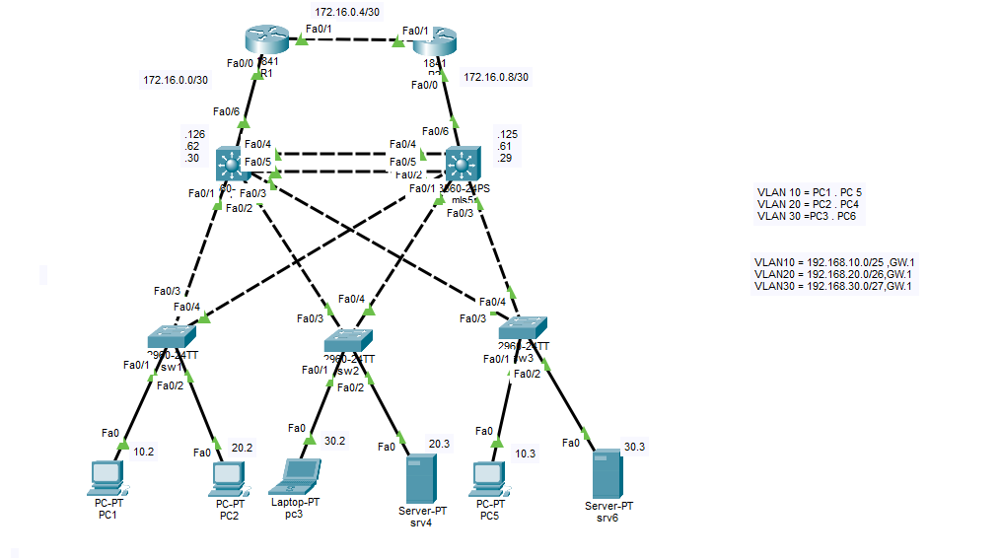
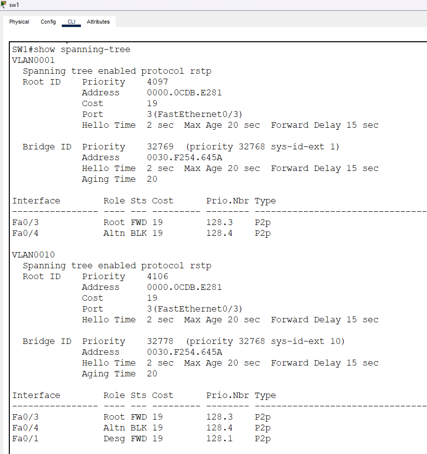
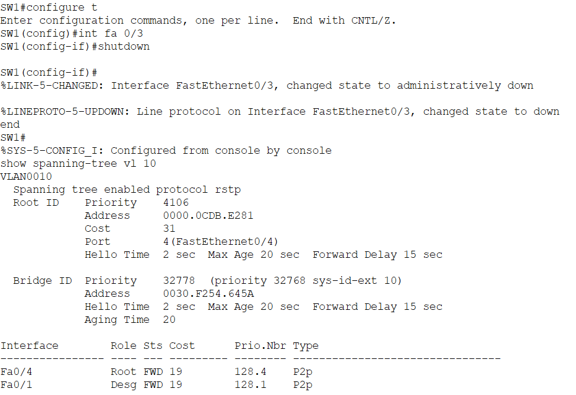
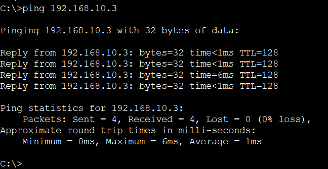

# Enterprise Network Lab

## Project Overview
This is an ongoing networking lab built using Cisco Packet Tracer to develop and demonstrate my practical networking skills.

The project focuses on network topology design, VLAN segmentation, IP addressing, and interconnected network devices.

## Network Topology

The current topology includes:
- 2 Routers
- Multiple Layer 2 and Layer 3 switches
- VLANs 10, 20, and 30
- Multiple end devices and servers
- Multiple links between network devices

## Technologies
- Cisco Packet Tracer
- VLANs
- IP Addressing and Subnetting
- Switching and Routing

## Project Status
 **Work in Progress**

This lab is continuously being improved as I expand my networking knowledge and practical experience.

## Project Files
- `lab 5.pkt` — Current network lab version

## Future Updates
Future improvements and configuration changes will be documented here as the project develops.
## RSTP Failover Testing

### Objective
To verify network redundancy and demonstrate how Rapid Spanning Tree Protocol (RSTP) maintains network connectivity when an active network link fails.

### Test Procedure
1. Checked the initial spanning-tree status using `show spanning-tree`.
2. Identified the root port and alternate blocked port.
3. Simulated a link failure by shutting down interface FastEthernet0/3 on SW1.
4. Verified that RSTP activated the alternate path through FastEthernet0/4.
5. Tested network connectivity using ICMP ping.

### Before Link Failure
The initial spanning-tree configuration showed:
- Fa0/3: Root Port (Forwarding)
- Fa0/4: Alternate Port (Blocking)

### After Link Failure
After shutting down Fa0/3, RSTP recalculated the network topology and selected the alternate path.

The updated spanning-tree status showed:
- Fa0/4: Root Port (Forwarding)
- Fa0/1: Designated Port (Forwarding)

### Connectivity Verification
An ICMP ping test was performed from PC1 to `192.168.10.3`.

**Results:**
- Packets sent: 4
- Packets received: 4
- Packet loss: 0%

### Conclusion
The test demonstrated successful RSTP failover. When the primary network link was disabled, the alternate path became active and network connectivity was maintained after convergence.

This confirms that the network topology supports redundant Layer 2 paths and automatic recovery from a single link failure.
